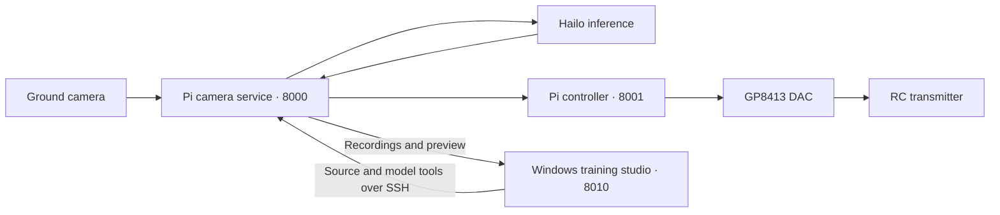

# DroneControl · Pi Vision

Ground-based visual tracking and experimental aircraft control using a Raspberry Pi 5, a Hailo accelerator, and a GP8413 DAC. A Windows training studio supports the workflow from recorded footage to labeled datasets, YOLO training, and model deployment.

## Capabilities

- **Live vision:** camera preview, Hailo inference, detection geometry, and clean video recording.
- **Aircraft controls:** manual and browser gamepad input, transmitter calibration, bounded image-space PD steering, and optional GPIO launch input.
- **Training studio:** video import, annotation, dataset exports, YOLO training, and model inspection.
- **Deployment tools:** source audits, staged updates, readiness checks, and rollback; model activation is a separate operation.
- **Telemetry:** recorded control sessions and downloadable flight logs.

## System overview



The camera and controller run as separate processes. The laptop provides development and training tools. Application source, trained models, and device calibration are managed separately.

## Getting started

### Windows training studio

From PowerShell:

```powershell
git clone https://github.com/vicdeo2911/DroneControl.git
cd DroneControl
.\setup-training.ps1
.\start-training.ps1
```

Open **http://127.0.0.1:8010/**. For a CPU-only installation, use `.\setup-training.ps1 -CpuOnly`. The setup script installs the pinned dependencies and uses NVIDIA CUDA packages when a compatible GPU is detected. Hailo compilation additionally requires the configured Docker compiler environment; see [TRAINING.md](TRAINING.md).

### Raspberry Pi

Use a Raspberry Pi 5 running 64-bit Raspberry Pi OS, a supported camera, and the appropriate Hailo hardware. Transmitter control additionally requires a GP8413 DAC, enabled I2C, and device-specific calibration.

```bash
git clone https://github.com/vicdeo2911/DroneControl.git
cd DroneControl
bash setup.sh
```

Follow [DEPLOYMENT.md](DEPLOYMENT.md) to configure service users, paths, hardware dependencies, and model artifacts before starting services. Models, datasets, recordings, and live calibration are excluded from this repository.

**Hardware operation:** this is an experimental control system. Verify wiring, calibration, output polarity, and stop behavior with propulsion disconnected before enabling outputs. Zero DAC voltage may command full throttle with inverted wiring. Keep the controller idle during deployment.

## Start here

| What you need | Guide |
|---|---|
| Which website does what, and which files render it | [WEB.md](WEB.md) |
| Which Python module owns each function | [ARCHITECTURE.md](ARCHITECTURE.md) |
| Install, audit or update software | [DEPLOYMENT.md](DEPLOYMENT.md) |
| Model locations, inventories and archived deployments | [MODEL_STORAGE.md](MODEL_STORAGE.md) |
| Record, label, train, test and activate models | [TRAINING.md](TRAINING.md) |
| Autonomous launch, tuning and GPIO input | [AUTONOMOUS.md](AUTONOMOUS.md) |
| Contributing and local checks | [CONTRIBUTING.md](CONTRIBUTING.md) |
| Publishing and future Git updates | [docs/GITHUB.md](docs/GITHUB.md) |

## Service addresses

The addresses below use the original development Pi IP. Substitute your own Pi address; deployment tools accept `--host ADDRESS --user USER`. Service unit templates also need your own user and installation paths.

- Pi camera: http://192.168.137.190:8000/ (`app.py`).
- Pi controls: http://192.168.137.190:8001/ (`remote_control.py`). Autonomous, calibration, joystick and flight logs are pages in this same application.
- Laptop training: http://127.0.0.1:8010/ (`training_studio.py`), started with `./start-training.ps1`.
- Laptop joystick tunnel: http://127.0.0.1:8002/ forwards the Pi controls application; it is not another application.

Use `.venv-training/Scripts/python.exe deploy.py plan` to see the source deployment payload without contacting the Pi. Source updates and HEF activation are separate operations. Settings, recordings, logs and models are not source files.

Earlier guides are preserved in [docs/history](docs/history/README.md). They describe previous states and are not current operating instructions.
